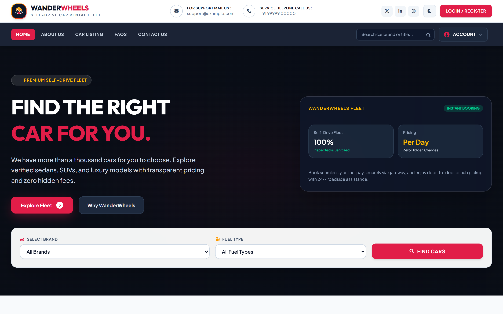
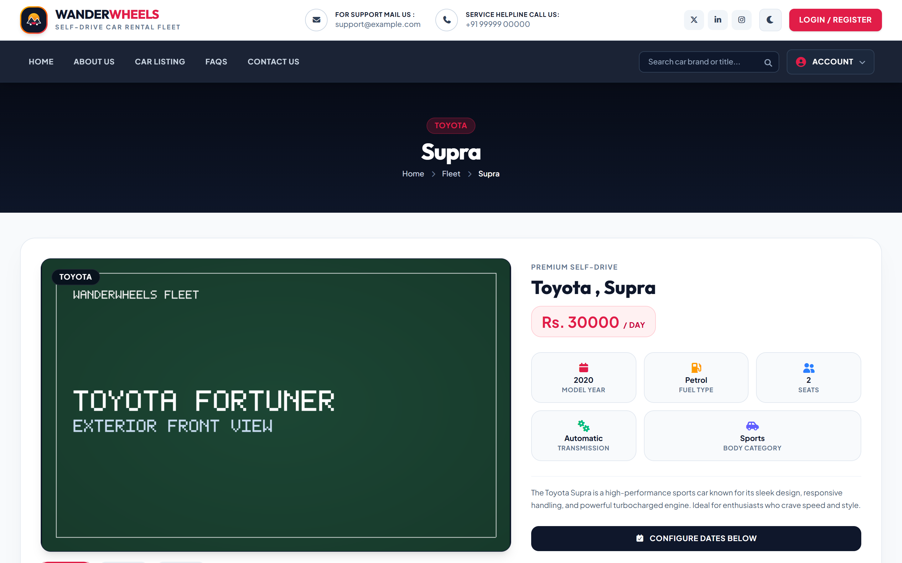
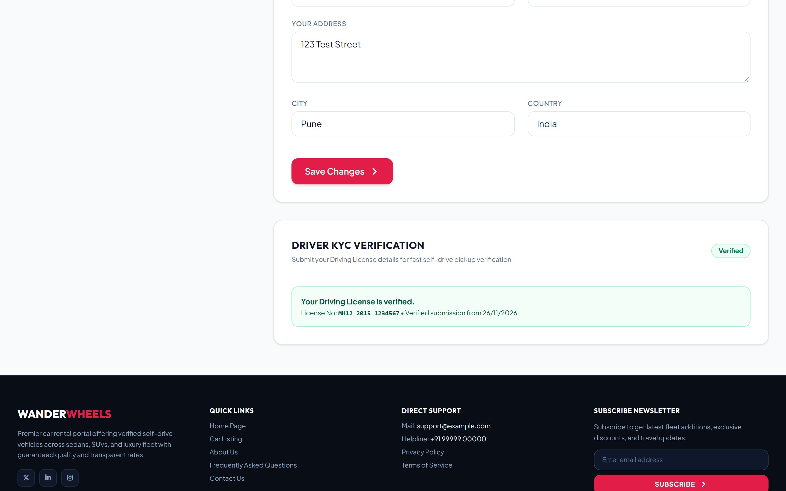
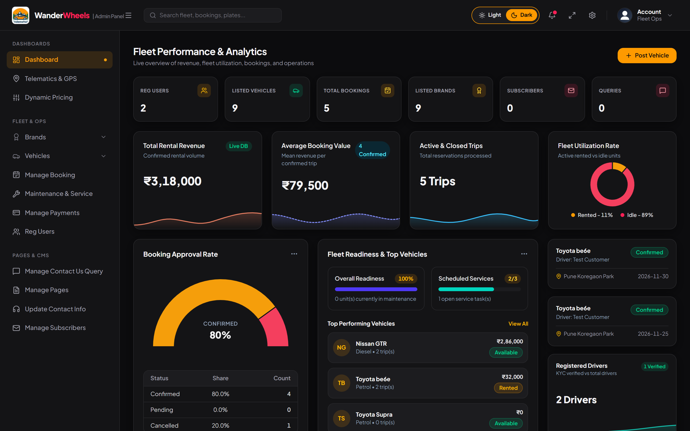
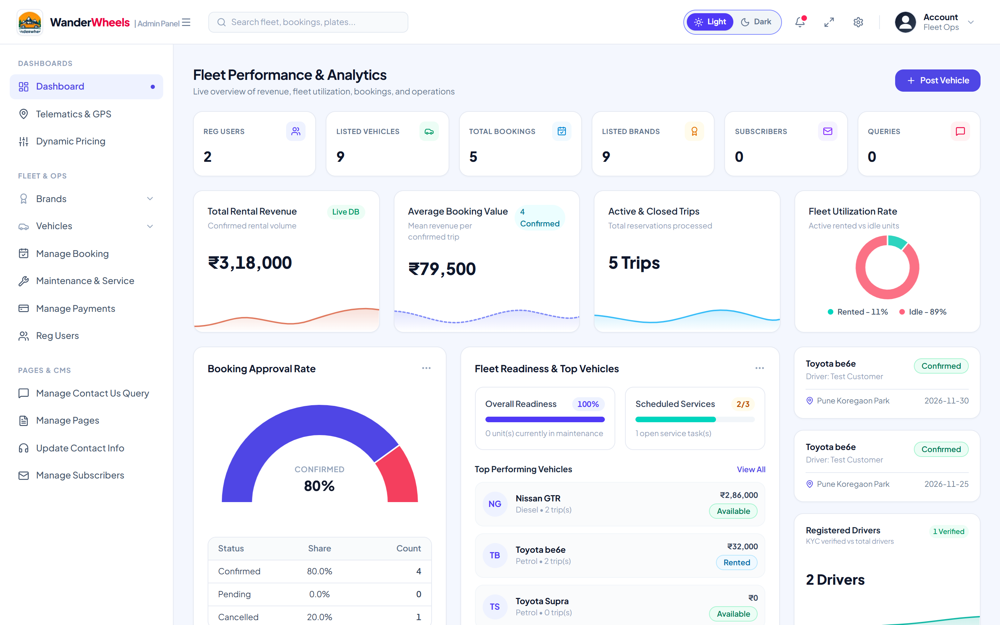
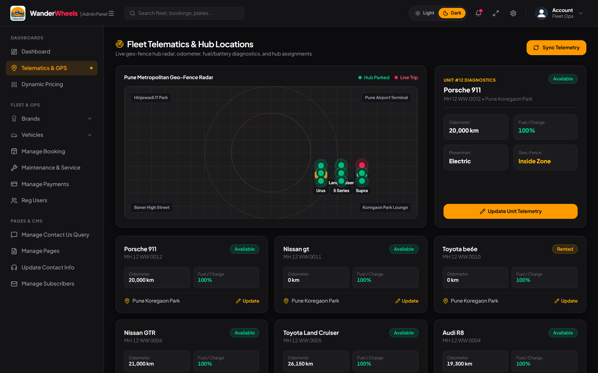
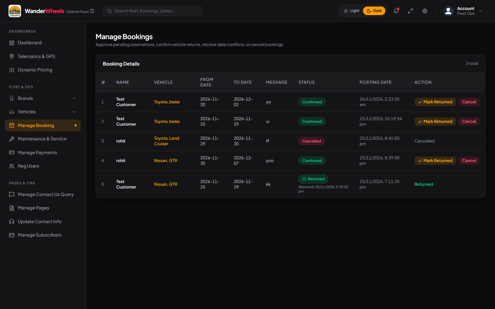
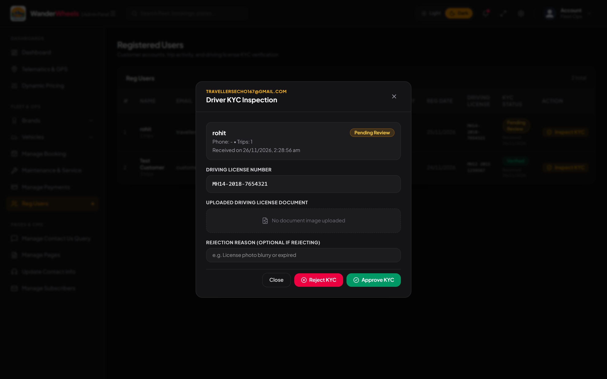

# WanderWheels Car Rental — Modern Full-Stack System

A modernized, secure car rental platform built with Node.js/Express, MySQL/MariaDB, and React (Vite).

## Services Architecture

- **`carrental-api`** (Port 4000): Hardened Express REST API with argon2 password hashing, double-submit cookie CSRF protection, refresh-token rotation, server-side inclusive date calculations, strict MIME/magic byte upload validation, Google OAuth 2.0 PKCE authentication, and an extensible online payment gateway adapter.
- **`carrental-web`** (Port 5173): Customer portal with vehicle browsing, interactive booking calendar, Google sign-in, online payment checkout modal (Razorpay / Mock Gateway), and printable HTML receipts.
- **`carrental-admin`** (Port 5175): Administrative portal for managing bookings, fleet vehicles, brands, testimonials, pages, and payments (reconciliation, transaction tracking, automated gateway handling).

---

## Screenshots / Demo

### Customer Portal (`carrental-web`)

#### Homepage & Modern Fleet Discovery


#### Vehicle Details, Technical Specifications & Booking Calendar


#### Customer Profile & Driver KYC Verification


---

### Admin Operations Portal (`carrental-admin`)

#### Fleet Ops Bento Dashboard — Obsidian & Amber Carbon (Dark Mode)


#### Fleet Ops Bento Dashboard — Light Mode


#### Pune Metropolitan Geo-Fence Radar & Live Fleet Telematics


#### Booking Management & Vehicle Return Tracking


#### Driver KYC Inspection & Verification Modal


---

## Online Payment Gateway Architecture

The system replaces manual payment workflows with an automated payment gateway architecture behind a clean adapter interface:

```
                  ┌────────────────────────┐
                  │ PaymentGateway (Base)  │
                  └───────────┬────────────┘
                              │
             ┌────────────────┴────────────────┐
             │                                 │
  ┌──────────▼───────────┐          ┌──────────▼───────────┐
  │   RazorpayGateway    │          │     MockGateway      │
  │ (Official REST API)  │          │ (In-Process Sandbox) │
  └──────────────────────┘          └──────────────────────┘
```

Both implementations execute through the **same** cryptographic verification code paths, order status handling, database transactions, and idempotency guarantees.

---

## Switching to the Real Razorpay Gateway

When you have real Razorpay credentials (test or live), follow these steps:

### 1. Update Environment Variables (`carrental-api/.env`)

Set `PAYMENT_GATEWAY` to `razorpay` and supply your credentials:

```ini
# ─── Payment Gateway Configuration ──────────────────────────────
PAYMENT_GATEWAY=razorpay

# Your Razorpay API Key ID (e.g. rzp_test_... for test mode, or rzp_live_... for production)
RAZORPAY_KEY_ID=rzp_test_yourKeyIdHere

# Your Razorpay API Key Secret
RAZORPAY_KEY_SECRET=yourKeySecretHere

# Your Razorpay Webhook Secret (configured in Razorpay Dashboard)
RAZORPAY_WEBHOOK_SECRET=yourWebhookSecretHere
```

> **Security Rules:**
> - In non-production environments (`NODE_ENV !== 'production'`), `RAZORPAY_KEY_ID` **must** start with `rzp_test_`. The server will refuse to start if a live key is supplied in non-production.
> - If `PAYMENT_GATEWAY=razorpay` but any of the three keys are missing, the server will refuse to start in production, and payment endpoints return HTTP `503 Service Unavailable` with a user-friendly UI notice: *"Online payments are currently unavailable."*
> - The server startup check will print only `[payment-config] Selected gateway: razorpay` and `set`/`missing` status for each variable. Secrets are **never** logged or committed.

### 2. Configure Webhooks in the Razorpay Dashboard

1. Navigate to **Razorpay Dashboard** → **Settings** → **Webhooks**.
2. Click **Add New Webhook**.
3. Set the **Webhook URL** to:
   ```
   https://<your-domain>/api/payments/webhook
   ```
4. Enter your secret in the **Secret** field and set the same value as `RAZORPAY_WEBHOOK_SECRET` in your `.env`.
5. Select the following **Active Events**:
   - `payment.captured`
   - `payment.failed`
   - `order.paid`
   - `refund.processed`
6. Save the webhook.

### 3. Automatic Security & CSP Adaptation

When `PAYMENT_GATEWAY=razorpay`:
- The API's Content Security Policy automatically allows scripts and frame connections to `https://checkout.razorpay.com` and `https://api.razorpay.com`.
- When `PAYMENT_GATEWAY=mock`, those external origins are omitted from the CSP, and no external scripts are loaded.

---

## Local Development & Testing with the Mock Gateway

To test the complete payment flow locally without Razorpay credentials:

### Configuration (`carrental-api/.env`)
```ini
NODE_ENV=development
DB_NAME=carrental_test
PAYMENT_GATEWAY=mock
MOCK_GATEWAY_SECRET=carrental_mock_gateway_secret_2026
```

> **Mock Safety Guard:**
> `MockGateway` **only** runs when `NODE_ENV !== 'production'` **AND** `DB_NAME === 'carrental_test'`. The application strictly refuses to start with the mock gateway in production or with a live database.

### Step-by-Step Manual Testing Flow

1. **Book a Vehicle:**
   - Go to `http://localhost:5173/` and log in as a customer.
   - Choose a vehicle and submit a booking request for any future dates.
   - The booking will initially show as `Not Confirm yet` (Status = 0).

2. **Admin Confirms the Booking:**
   - Log into Admin Portal at `http://localhost:5175/login` (`admin` / password printed by `npm run db:setup` or configured via `SEED_ADMIN_PASSWORD`).
   - Go to **Manage Bookings** and click **Confirm** for the booking.

3. **Customer Initiates Payment:**
   - In the Customer Portal, go to **My Bookings** (`http://localhost:5173/my-booking`).
   - The booking displays `Confirmed` with a **Pay now** button.
   - Click **Pay now** to open the payment modal.
   - Note the yellow warning banner: *"Test payment gateway (mock): no real money is charged"*.
   - Verify the booking summary: vehicle name, dates, rate per day, and server-computed total amount.

4. **Simulate Payment Failure & Retry:**
   - Click **Pay securely**. The Mock Payment Simulator popup appears.
   - Click **Simulate failure**.
   - Notice the inline error message: *"Payment failed. Your booking is still confirmed. You can try again."* along with a **Retry** button.
   - Click **Retry** to return to the payable state.

5. **Simulate Payment Success:**
   - Click **Pay securely** again.
   - Select the **UPI (Mock)** or **Card (Mock)** tab.
   - Click **Simulate success**.
   - The modal transitions to: *"Payment of Rs. X was confirmed successfully!"* with a **View Receipt** link.
   - Close the modal.
   - The booking on **My Bookings** now displays `Payment Status: Confirmed` and a **Download Receipt** button.

6. **View & Print Receipt:**
   - Click **Download Receipt** (opens `/receipt/:bookingId`).
   - The receipt renders with Receipt #, Customer details, Duration, Rate per Day, Server-Calculated Total, Payment Method (`mock_upi`), and Status (`Confirmed`).

7. **Admin Manage Payments Verification:**
   - In the Admin Portal, go to **Manage Payments** (`http://localhost:5175/manage-payments`).
   - The table shows columns: **Gateway** (`Mock`), **Order ID**, **Payment ID**, **Method**, **Status** (`confirmed`).
   - Confirm and Reject buttons are hidden for automated payments (shows `Automated`).
   - If a payment is pending, a **Reconcile** action is available to poll the gateway directly.

---

## Testing & CLI Tools

### 1. Mock Webhook Trigger Tool
Simulate incoming gateway webhooks locally with HMAC signature verification:
```powershell
# In carrental-api:
npm run dev:fire-webhook -- <orderId> captured
npm run dev:fire-webhook -- <orderId> failed
npm run dev:fire-webhook -- <orderId> refunded
```

### 2. Full Test Suite (Jest Unit & Integration)
```powershell
# In carrental-api:
npm test
```
*Runs all 9 test suites (102 tests passing 100%), including mock gateway unit tests, mocked Razorpay HTTP tests, amount tampering tests, signature replay tests, double-spend race tests, IDOR tests, and webhook deduplication tests.*

### 3. Playwright Real-Browser Verification Suites
All Playwright suites run with **real clicks only** (no `force: true`, no `setChecked`, zero direct DOM manipulations):
```powershell
# In project root:
node test-payment-playwright.cjs   # Online Payment Gateway end-to-end
node test-post-vehicle.cjs         # Admin Post Vehicle & real checkboxes
node test-e2e-flow.cjs             # Double-booking race conditions
node test-google-playwright.cjs    # Google OAuth 2.0 PKCE flow
```
